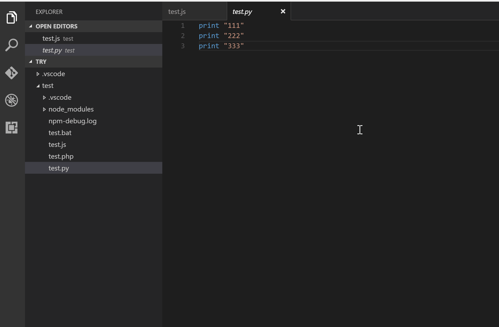

# Quick Runner

[](https://github.com/navneetguptacse/quick-runner)
[](https://opensource.org/licenses/MIT)

Run code snippet or code file for multiple languages: **C, C++, Java, JavaScript, PHP, Python, Perl, Perl 6, Ruby, Go, Lua, Groovy, PowerShell, BAT/CMD, BASH/SH, F# Script, F# (.NET Core), C# Script, C# (.NET Core), VBScript, TypeScript, CoffeeScript, Scala, Swift, Julia, Crystal, OCaml Script, R, AppleScript, Elixir, Visual Basic .NET, Clojure, Haxe, Objective-C, Rust, Racket, Scheme, AutoHotkey, AutoIt, Kotlin, Dart, Free Pascal, Haskell, Nim, D, Lisp, Kit, V, SCSS, Sass, CUDA, Less, Fortran, Ring, Standard ML, Zig, Mojo, Erlang, SPWN, Pkl, Gleam**, and custom command.

## Features

- Run code file of current active Text Editor
- Run code file through context menu of file explorer
- Run selected code snippet in Text Editor
- Run code per Shebang
- Run code per filename glob
- Run custom command
- Stop code running
- View output in Output Window
- Set default language to run
- Select language to run
- Support REPL by running code in Integrated Terminal

## Usages

- **To run code:**
  - Use shortcut `Ctrl+Alt+N`
  - Or press `F1` and then select/type `Run Code`
  - Or right click the Text Editor and then click `Run Code` in editor context menu
  - Or click `Run Code` button in editor title menu
  - Or click `Run Code` button in context menu of file explorer
- **To stop the running code:**
  - Use shortcut `Ctrl+Alt+M`
  - Or press `F1` and then select/type `Stop Code Run`
  - Or click `Stop Code Run` button in editor title menu
  - Or right click the Output Channel and then click `Stop Code Run` in context menu



- **To select language to run:**
  - Use shortcut `Ctrl+Alt+J`
  - Or press `F1` and then select/type `Run By Language`
  - Then type or select the language to run: e.g. `php, javascript, bat, shellscript...`


- **To run custom command:**
  - Use shortcut `Ctrl+Alt+K`
  - Or press `F1` and then select/type `Run Custom Command`

## Configuration

Quick Runner uses the `quick-runner.*` settings namespace in your VS Code settings.

### Quick Example

To configure output options and custom compiler/runtime commands in your `settings.json`:

```json
{
  "quick-runner.clearPreviousOutput": true,
  "quick-runner.showExecutionMessage": false,
  "quick-runner.executorMap": {
    "cpp": "clang++ -std=c++20 -O2 -Wall \"$fileName\" -o \"$fileNameWithoutExt\" && \"./$fileNameWithoutExt\"",
    "python": "python -u \"$fileName\""
  }
}
```

### Executor Map

Make sure the executor PATH of each language is set in your environment variable.
You can customize `quick-runner.executorMap` to set specific commands or paths for any language:

```json
{
  "quick-runner.executorMap": {
    "javascript": "node",
    "php": "C:\\php\\php.exe",
    "python": "python -u \"$fileName\"",
    "perl": "perl",
    "ruby": "C:\\Ruby23-x64\\bin\\ruby.exe",
    "go": "go run",
    "html": "\"C:\\Program Files (x86)\\Google\\Chrome\\Application\\chrome.exe\"",
    "java": "cd $dir && javac $fileName && java $fileNameWithoutExt",
    "c": "cd $dir && gcc $fileName -o $fileNameWithoutExt && $dir$fileNameWithoutExt",
    "cpp": "clang++ -std=c++20 -O2 -Wall \"$fileName\" -o \"$fileNameWithoutExt\" && \"./$fileNameWithoutExt\""
  }
}
```

### Supported Customized Parameters

- `$workspaceRoot`: The path of the folder opened in VS Code
- `$dir`: The directory of the code file being run
- `$dirWithoutTrailingSlash`: The directory of the code file being run without a trailing slash
- `$fullFileName`: The full name of the code file being run
- `$fileName`: The base name of the code file being run (without directory)
- `$fileNameWithoutExt`: The base name of the code file being run without its extension
- `$driveLetter`: The drive letter of the code file being run (Windows only)
- `$pythonPath`: The path of Python interpreter (set by `Python: Select Interpreter` command)

> [!NOTE]
> Please take care of backslashes and spaces in file paths:
> - Backslash: please use `\\`
> - If there are spaces in file paths, please use `\"` to wrap your path

### Executor Map by Glob

You can set executors per filename glob:

```json
{
  "quick-runner.executorMapByGlob": {
    "pom.xml": "cd $dir && mvn clean package",
    "*.test.js": "tap",
    "*.js": "node"
  }
}
```

### Default Language

Set default language when file language cannot be determined:

```json
{
  "quick-runner.defaultLanguage": "javascript"
}
```

### Executor Map by File Extension

```json
{
  "quick-runner.executorMapByFileExtension": {
    ".vbs": "cscript //Nologo",
    ".kt": "cd $dir && kotlinc $fileName -include-runtime -d $fileNameWithoutExt.jar && java -jar $fileNameWithoutExt.jar"
  }
}
```

### Custom Command

```json
{
  "quick-runner.customCommand": "echo Hello"
}
```

### Working Directory (CWD)

```json
{
  "quick-runner.cwd": "path/to/working/directory"
}
```

**About CWD Setting priority:**
1. By default, use the `quick-runner.cwd` setting
2. If `quick-runner.cwd` is not set and `quick-runner.fileDirectoryAsCwd` is `true`, use the directory of the file to be executed
3. If `quick-runner.cwd` is not set and `quick-runner.fileDirectoryAsCwd` is `false`, use the path of root folder open in VS Code
4. If no folder is open, use the OS temp directory

### Output & Execution Controls

- `quick-runner.clearPreviousOutput`: Whether to clear previous output before each run (default is `false`).
- `quick-runner.showExecutionMessage`: Whether to show extra execution messages like `[Running] ...` and `[Done] ...` (default is `true`).
- `quick-runner.saveAllFilesBeforeRun`: Whether to save all files before running (default is `false`).
- `quick-runner.saveFileBeforeRun`: Whether to save the current file before running (default is `false`).
- `quick-runner.runInTerminal`: Whether to run code in Integrated Terminal (default is `false`).
- `quick-runner.preserveFocus`: Whether to preserve focus on code editor after code run is triggered (default is `true`).
- `quick-runner.ignoreSelection`: Whether to ignore selection to always run entire file (default is `false`).
- `quick-runner.respectShebang`: Whether to respect Shebang to run code (default is `true`).
- `quick-runner.showRunIconInEditorTitleMenu`: Whether to show 'Run Code' icon in editor title menu (default is `true`).
- `quick-runner.showStopIconInEditorTitleMenu`: Whether to show 'Stop Code Run' icon in editor title menu when code is running (default is `true`).
- `quick-runner.showRunCommandInEditorContextMenu`: Whether to show 'Run Code' command in editor context menu (default is `true`).
- `quick-runner.showRunCommandInExplorerContextMenu`: Whether to show 'Run Code' command in explorer context menu (default is `true`).
- `quick-runner.temporaryFileName`: Temporary file name used in running selected code snippet (default is `"tempQuickRunnerFile"`).
- `quick-runner.terminalRoot`: For Windows system, replaces Windows style drive letter in command with Unix style root when using a custom shell (default is `""`).

## Change Log

See Change Log [here](https://github.com/navneetguptacse/quick-runner/blob/main/CHANGELOG.md).

## Issues

Submit [issues](https://github.com/navneetguptacse/quick-runner/issues) if you find any bug or have suggestions.

## Contribution

Fork the [repo](https://github.com/navneetguptacse/quick-runner) and submit pull requests.
